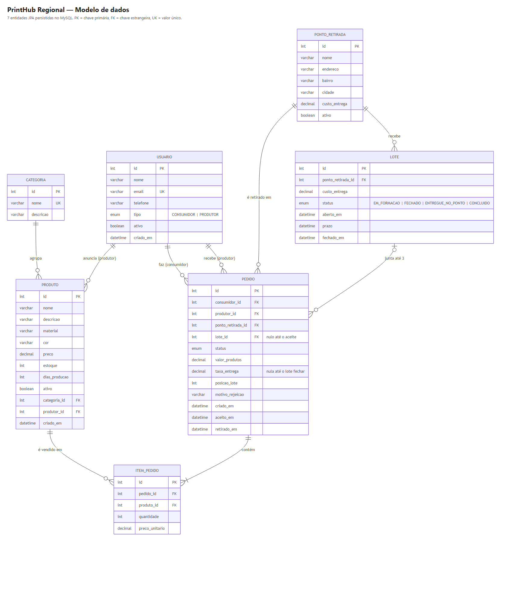

# PrintHub Regional — Backend REST com Spring Boot

Projeto Integrador · Engenharia de Software, 4º termo · Padrões de Desenvolvimento Web · UNIFIO

## Integrantes

| Nome completo | ID acadêmico |
|---|---|
| Miguel Vita de Oliveira | 272758 |
| Ana Livia Caprioli | 272714 |

## Sobre a aplicação

O **PrintHub Regional** é um marketplace regional de produtos impressos em 3D. Produtores da região anunciam as peças que imprimem, e consumidores compram e retiram num ponto de retirada parceiro.

O diferencial é o **lote coletivo de entrega**. Os pedidos aceitos que vão para o mesmo ponto entram num lote. Quando o lote completa 3 pedidos, ele fecha e o custo de levar as peças até o ponto é dividido entre os pedidos. Assim, cada consumidor paga só uma parte do frete.

## Objetivo do backend

Oferecer uma API REST que:

- mantenha o catálogo (categorias, produtos e produtores), os pontos de retirada e os usuários;
- controle o pedido do começo ao fim: criação, aceite ou rejeição pelo produtor, entrada no lote, recebimento no ponto e retirada;
- garanta as regras do negócio, como estoque, produtor único por pedido e cancelamento só até o lote fechar;
- proteja as operações por perfil de acesso (ADMIN, PRODUTOR e CONSUMIDOR).

## Tecnologias

- Java 21
- Spring Boot 4.1.1 (Spring Web MVC, Spring Data JPA, Bean Validation e Spring Security)
- MySQL 8
- Lombok
- Maven, com o wrapper `mvnw` incluído
- JUnit 5, MockMvc e H2, só nos testes automatizados
- Postman

## Arquitetura em camadas

```
src/main/java/br/edu/unifio/printhub/
├── entidades/      objetos do domínio mapeados com JPA (Categoria, Usuario, Produto, PontoRetirada, Lote, Pedido, ItemPedido)
├── repositorios/   acesso ao banco com Spring Data JPA, incluindo as consultas personalizadas
├── servicos/       regras de negócio (é aqui que ficam as validações que geram 409)
├── recursos/       controllers REST: recebem a requisição e chamam o service
├── dtos/           objetos de entrada (com Bean Validation) e de saída da API
├── excecoes/       exceções próprias e o tratamento centralizado (@RestControllerAdvice)
└── seguranca/      Spring Security: HTTP Basic, usuários em memória e respostas 401/403
```

Os controllers (`recursos`) **nunca acessam os repositórios**. Todo acesso a dados passa pelos services.

## Modelo de dados



Sete entidades:
- **Categoria** 1—N **Produto** N—1 **Usuario** (produtor).
- **Usuario** (consumidor) 1—N **Pedido**; o **Pedido** pertence a um **PontoRetirada** e, depois do aceite, a um **Lote**.
- **Pedido** 1—N **ItemPedido** N—1 **Produto**.
- **PontoRetirada** 1—N **Lote**.

## Requisitos do trabalho e onde estão

| Requisito | Onde |
|---|---|
| 5+ entidades com JPA e relacionamentos | `entidades/` (7 entidades) e o diagrama acima |
| CRUD completo de todas as entidades | `recursos/`; os itens do pedido ficam em `/pedidos/{id}/itens` |
| Arquitetura em camadas | pacotes `entidades`, `repositorios`, `servicos` e `recursos` |
| Regras de negócio (2+) | `servicos/`, por exemplo estoque insuficiente, produtor que compra o próprio produto, lote fechado, categoria com produtos |
| Bean Validation e `@Valid` | `dtos/*Requisicao.java` e os `@Valid` nos controllers |
| Exceção própria e `@RestControllerAdvice` | `RecursoNaoEncontradoException`, `RegraNegocioException` e `TratadorDeErros` (400, 404 e 409) |
| Consultas personalizadas (2+) | `ProdutoRepositorio` (por categoria, por nome, estoque baixo com `@Query`), `PedidoRepositorio` (por status, por consumidor com `@Query`), `LoteRepositorio` e `UsuarioRepositorio` |
| Spring Security HTTP Basic, 2+ usuários e 2+ perfis | `seguranca/ConfiguracaoSeguranca.java` (3 usuários, 3 perfis); aceitar e rejeitar pedido são só do PRODUTOR |
| Diferença entre 401 e 403 | `seguranca/RespostasDeSeguranca.java` (respostas em JSON); pastas 10 e 11 da coleção do Postman |
| Funcionalidade específica do PI | lote coletivo: `servicos/LoteServico.java` e `servicos/RateioEntrega.java` |
| Testes no Postman | `postman/projeto-integrador.postman_collection.json` |

## Como executar

### 1. Pré-requisitos

- JDK 21
- MySQL 8: instalado na máquina **ou** pelo Docker (opção B abaixo)

Não é preciso instalar o Maven: o projeto traz o `mvnw`.

### 2. Configurar o acesso ao MySQL

**Opção A — MySQL instalado na máquina (porta 3306).** A aplicação cria sozinha o banco `printhub`. O usuário e a senha do MySQL vêm de variáveis de ambiente. Se não forem definidas, os padrões são `root` / `root`.

PowerShell (Windows):

```powershell
$env:DB_USUARIO = "root"
$env:DB_SENHA = "sua_senha_do_mysql"
```

Bash (Linux/macOS):

```bash
export DB_USUARIO=root
export DB_SENHA=sua_senha_do_mysql
```

Também dá para trocar a URL inteira com `DB_URL`.

**Opção B — MySQL pelo Docker.** O `docker-compose.yml` sobe um MySQL 8.4 na porta 3307, com usuário de teste `printhub` / `printhub123`:

```bash
docker compose up -d
```

PowerShell:

```powershell
$env:DB_URL = "jdbc:mysql://localhost:3307/printhub?createDatabaseIfNotExist=true&serverTimezone=America/Sao_Paulo"
$env:DB_USUARIO = "printhub"
$env:DB_SENHA = "printhub123"
```

### 3. Subir a API

```bash
./mvnw spring-boot:run        # Linux/macOS
mvnw.cmd spring-boot:run      # Windows
```

A API fica em `http://localhost:8080`. A cada inicialização as tabelas são recriadas e os dados de exemplo do `import.sql` são carregados, então todo teste começa do mesmo estado.

### 4. Testar no Postman

1. No Postman: **Import** → escolha `postman/projeto-integrador.postman_collection.json`.
2. A coleção já tem as variáveis (`baseUrl` e os usuários e senhas de teste) e a autenticação HTTP Basic configurada em cada requisição.
3. Com a API recém-iniciada, rode as requisições **na ordem das pastas**. Cada requisição tem a resposta salva como exemplo (**Save Response**).

### 5. Testes automatizados (opcional)

```bash
./mvnw test
```

Os testes usam o banco H2 em memória e não precisam do MySQL.

## Usuários de teste

Senhas criadas só para esta atividade:

| Usuário | Senha | Perfil |
|---|---|---|
| `admin` | `admin123` | ADMIN |
| `produtor` | `produtor123` | PRODUTOR |
| `consumidor` | `consumidor123` | CONSUMIDOR |

## Documentação dos endpoints

Ver [`docs/documentacao-api.md`](docs/documentacao-api.md): todas as rotas, o perfil exigido, os corpos de exemplo, as regras de negócio e o passo a passo do lote coletivo.
